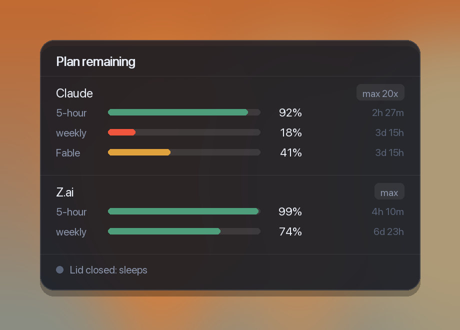

# fuelgauge

**How much AI you have left.**

A fuel gauge for your AI plans, on your macOS desktop. The bars drain as you
spend, so a short bar means you're nearly out. Claude and Z.ai work out of the
box; any other provider is ten lines away.

Runs on [Übersicht](https://tracesof.net/uebersicht/).



---

## Install

```bash
git clone https://github.com/majdiq1/fuelgauge.git
cd fuelgauge
./install.sh
```

Then: Übersicht menu bar → **Refresh All Widgets**.

Remove it with `./uninstall.sh`.

---

## Using it

**Read the bars.** Each one is how much is **left**. Full and green is good.
Short and red means you're nearly out. The time on the right is when that
window resets.

**Check before a long job.** That's the point of it. A four-hour agent run with
11% of your week left will stop halfway.

**Toggle the lid.** Click the bottom row. Grey means closing your laptop stops
your work; green means it keeps running. macOS asks for your password.

**Watch for amber on the lid row.** That means it's set to keep running *and*
you're on battery — a closed laptop that never sleeps will drain and get hot.

**Refresh now.** Click **Plan remaining**. It also refreshes itself every 5
minutes.

### Adding your own provider

Say you use Groq. Make a file:

```bash
cat > ~/.config/dev-hud/providers/40-groq <<'EOF'
#!/usr/bin/env bash
# print one line of JSON — that's the whole contract
echo '{"name":"Groq","windows":[{"label":"daily","pct":37}]}'
EOF
chmod +x ~/.config/dev-hud/providers/40-groq
```

Refresh the widget and Groq appears. Replace the hardcoded 37 with a real API
call and you're done. See `providers/20-zai` for a working example.

**Test it without waiting for a refresh:**

```bash
bash ~/.ai-usage.sh --debug
```

That runs each provider and shows exactly what it printed — the fastest way to
find out why one isn't showing.

---

## What it shows

Bars show what's **remaining**, not what you've spent — a fuel gauge, draining
toward empty. A short bar means you're nearly out, which is the reading you
want at a glance.

Colour keys off consumption, not the displayed number: green above 50% left,
amber below, red under 20%. Colouring by the displayed value would turn
*nearly empty* green, which is exactly backwards.

It also shows whether **closing your laptop lid** will stop your work, and lets
you toggle that with a click.

---

## Adding any LLM

The widget doesn't know about Claude or Z.ai specifically. It renders whatever
it finds in `~/.config/dev-hud/providers/`.

A provider is **any executable that prints one line of JSON**:

```json
{"name":"Groq","tier":"free","windows":[{"label":"daily","pct":44}]}
```

| Field | |
|---|---|
| `name` | heading on the widget |
| `tier` | optional badge, e.g. your plan name |
| `windows[].label` | short name — `5-hour`, `weekly`, `monthly` |
| `windows[].pct` | percent **used**, 0–100. The widget shows what's left. |
| `windows[].resets` | optional, epoch milliseconds |

Failed? Print `{"name":"Groq","error":"no key"}` and the widget shows the
reason instead of the provider silently vanishing.

Write it in bash, Python, Node — anything. Make it executable, drop it in the
folder. No code here changes.

### What ships

| | |
|---|---|
| `10-claude-local` | Claude's 5-hour window. **No key, no login, no network** — reads the Claude desktop app's own local record. |
| `20-zai` | Z.ai coding plan, every quota window. Key read from your ZCode config, or `~/.config/dev-hud/zai.key`. |
| `30-openrouter.example` | OpenRouter key credit limit. Rename without `.example` and `chmod +x` to enable. |

Files run in filename order, so the number prefix sets the order on the widget.
`chmod -x` disables one without deleting it.

```bash
bash ~/.ai-usage.sh --debug     # run each provider, show its raw output
```

### Why Claude only shows 5 hours

The Claude desktop app writes its 5-hour limit state to disk because it needs
it for the "approaching your limit" warning. The weekly and per-model figures
are fetched live and never stored. Reading those would mean unlocking the app's
saved login — not something to publish.

If you use Claude Code, note that its status line is *meant* to carry a
`rate_limits` block. On the versions I tested it comes through `null`, so
that route isn't used here.

---

## The lid toggle

Click the bottom row to toggle whether closing your MacBook stops your work.
macOS asks for your password — the widget never sees it.

Worth understanding: **Amphetamine and `caffeinate` cannot do this.** They use
power assertions, which stop the idle timer but can't override the hardware
lid-close trigger. Only the kernel's `SleepDisabled` flag survives a lid close.
That's what this sets, via `pmset`.

A closed laptop kept awake on battery will drain and overheat. The row turns
**amber** when it's on and you're unplugged.

Skip the password prompt each time:

```bash
sudo sh -c 'printf "%s ALL=(root) NOPASSWD: /usr/bin/pmset\n" "$SUDO_USER" > /tmp/la.tmp \
  && visudo -c -f /tmp/la.tmp \
  && install -m 440 -o root -g wheel /tmp/la.tmp /etc/sudoers.d/lid-awake \
  && rm /tmp/la.tmp && echo INSTALLED'
```

That grants passwordless `sudo` for `pmset` and nothing else — it can't be used
to get a root shell. It validates the file before installing it, because a
malformed sudoers file locks you out of `sudo` entirely. Undo with
`sudo rm /etc/sudoers.d/lid-awake`.

Terminal equivalents: `~/.lid-awake.sh on|off|status`

---

## Privacy

No telemetry, no server. Each provider script calls its own API from your
machine with your own key. Keys stay in files you control, mode `600`.

---

## Options

At the top of `widget/usage.jsx`: `POSITION`, `WIDTH`, `HEIGHT`,
`refreshFrequency` (default 5 minutes). Click the **Plan remaining** heading to
refresh immediately.

---

## Licence

MIT. See [LICENSE](LICENSE).
